<h1 align="center">DeltaCE</h1>

  <b>The calculus of change, shown step by step, on your TI-84 Plus CE.</b> 
  Type math the way it looks. Get exact answers the way your textbook writes them, and the steps behind them.

  
  
  
  

  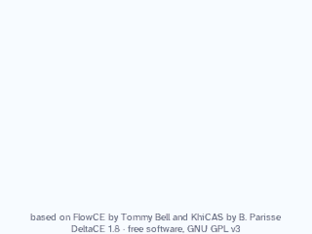
  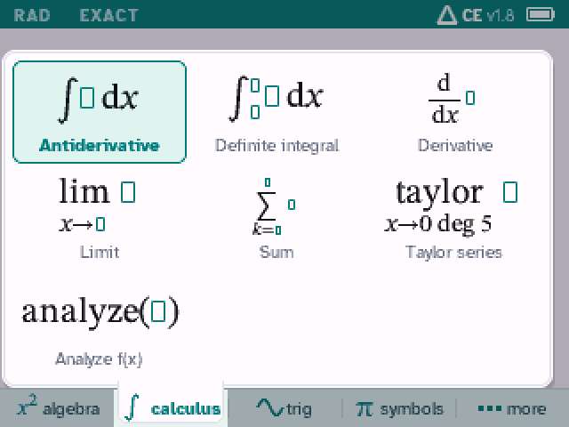

DeltaCE is a computer algebra system for the TI-84 Plus CE, built for algebra and Calc 1 to 3. It
is a fork of [FlowCE](https://github.com/tommyb3ll/FlowCE) (itself a fork of KhiCAS): everything
FlowCE Steps does, plus steps for algebra, a new graph screen, function analysis, units, and a look
of its own. Answers are exact: `π²/6`, not `1.64493`; `ln|sec x + tan x| + C`. The decimal value
sits right under the exact one.

**[Install it from the DeltaCE page](https://bupfff.github.io/DeltaCE/)**: plug in the calculator,
click Install, then press `enter` once on the calculator.

## What it does

- **The steps.** After an answer, press `enter` to see how to get it, the way a worked example in a
  textbook does: derivatives, integrals, limits, sums and Taylor series (FlowCE Steps), and in
  algebra, linear and quadratic equations (always by the formula: a, b and c, the discriminant,
  the roots simplified), rational and radical equations (excluded values, the LCD, every candidate
  checked), and factoring (GCF, differences of squares and cubes, two numbers or the ac method,
  grouping, rational roots). Each step names its rule; `▲` `▼` move between them.
- **Answers like your textbook, and their other forms.** `F4` cycles an answer's forms: simplified,
  one fraction, factored, expanded, the completed square, long division, partial fractions,
  decimal; `enter` on one shows its work. On an antiderivative, `F4` checks it by differentiating.
- **What to do next, one key away.** Under an answer, a row of its likeliest next steps: Factor or
  Expand, Solve = 0, Graph, or Derivative, Integral, Graph for a function of sin, ln, √... `▶`
  picks one, `enter` does it; *more* lists them all.
- **A graph screen that knows its key points.** Zeros, extrema, inflection points and crossings,
  exact (`(π/3, √3/2)`), labeled on the graph. Pan and zoom while a key is held, trace, a table, the
  tangent line, the area under the curve, value at x, solve f(x) = …, max and min on [a, b].
  Equations in x and y (circles, ellipses, hyperbolas, tilted conics), parametric and polar curves,
  slope fields with solutions through points.
- **Statistics and regression.** *more* → Statistics: your data in two columns (the lists `L1`
  and `L2`, shared with the console). A column's statistics with its box plot: mean, sum, sample and
  population standard deviation, min, Q1, median, Q3, max (the quartiles the TI's way). A curve
  fitted to the points (linear, quadratic, cubic, exponential, power, logarithmic) in exact form
  when it can be (`y = 33/7 x + 324/7`) with r and r², a predicted y, and the points with the curve
  on the graph screen, traced point by point. `mean(L1)`, `linear_regression(L1,L2)` and the
  others work in the console too.
- **Function analysis.** `analyze(f)` (or F2 → Analyze f(x)): domain, intercepts, symmetry,
  asymptotes and holes, increasing and decreasing, extrema, concavity, inflection points.
- **Units.** A units menu on `alpha` `F4`: 72 units in 8 categories, Celsius to Fahrenheit, results
  written as textbooks write them (`96.5606 km/h`, `120 min`).
- **Calculus 1, 2 and 3.** Trig integrals, trig substitution, partial fractions, arc length,
  improper integrals that say *diverges*, limits that say *does not exist*, series and power series,
  differential equations with initial values, parametric and polar areas, gradients, multiple
  integrals, complex numbers, vectors, matrices.
- **Type math as it looks.** Fractions, powers, roots, integrals, sums, limits and derivatives are
  drawn in 2D as you type; commands come with a box for each argument and a line saying what they
  do. **▲** walks through your past calculations, **▼** searches every command.
- **Keys that work like a TI's.** `(-)` is a minus sign and `2nd (-)` is **Ans**; starting a line
  with `×`, `÷`, `+`, `−` or `^` works on the last answer; `2nd enter` brings back your last input;
  `sto→` stores.
- **Paper and Night themes**, with DeltaCE's teal.
- **Tested on the calculator itself.** Before a release, Calc 1–3 and algebra problem lists and a
  220-input class session run on an emulated TI-84 Plus CE, every answer checked against a
  computer's, along with out-of-memory and long-session tests. A long calculation shows
  *Calculating*; **ON** stops it.

## Screenshots

| | | |
|:-:|:-:|:-:|
| 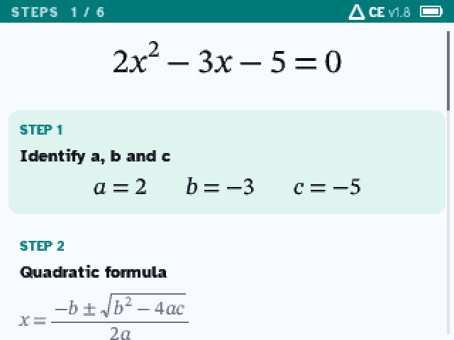 | 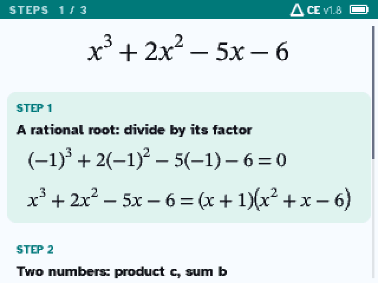 | 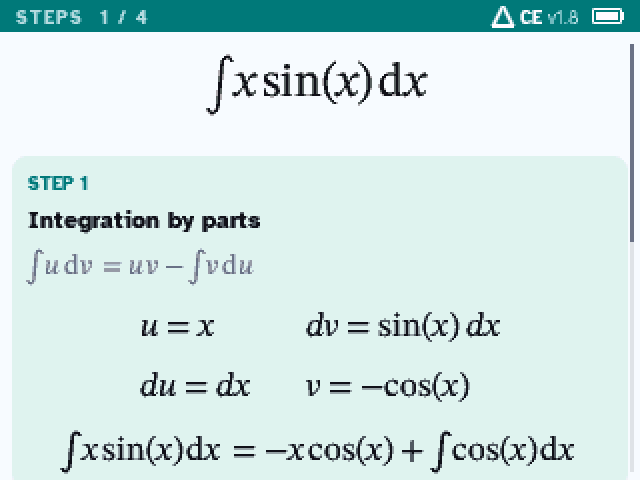 |
| steps: a quadratic, by the formula | steps: factoring | steps: integration by parts |
| 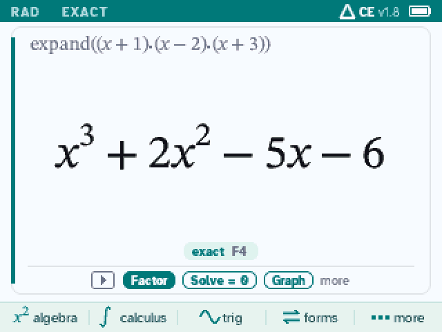 | 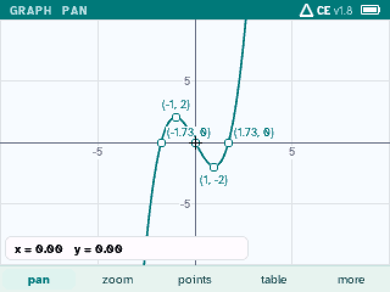 | 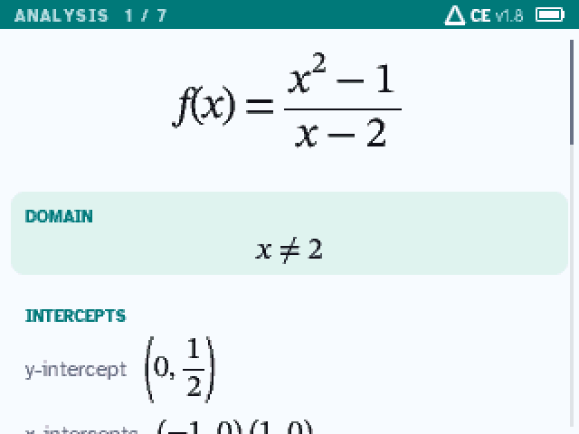 |
| `▶`: what to do next | key points, exact | `analyze(f)` |
| 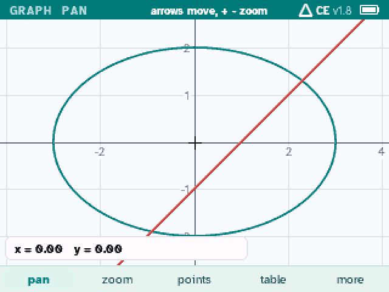 | 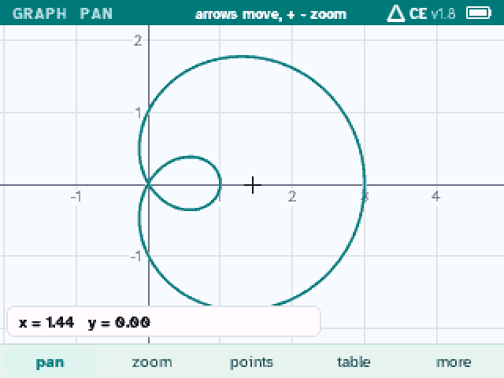 | 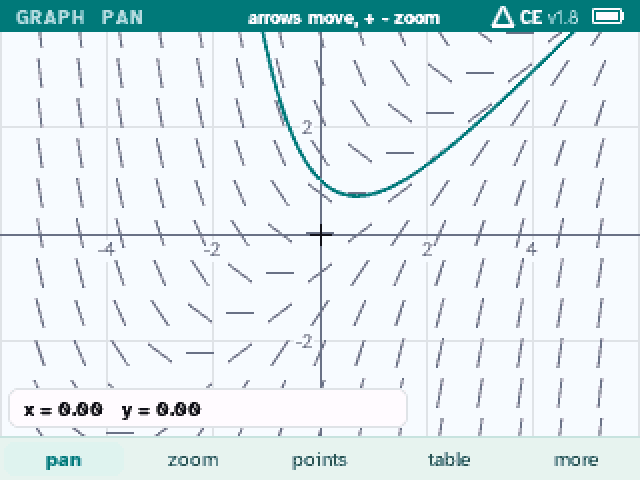 |
| equations in x and y | polar curves | slope fields |
| 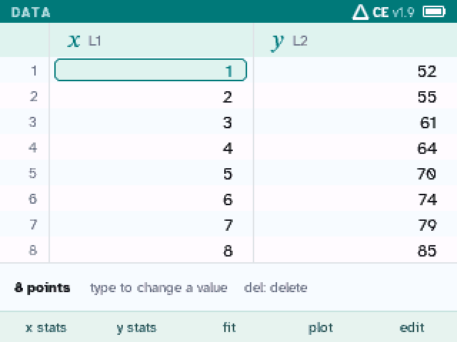 | 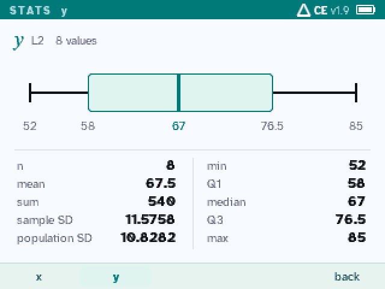 | 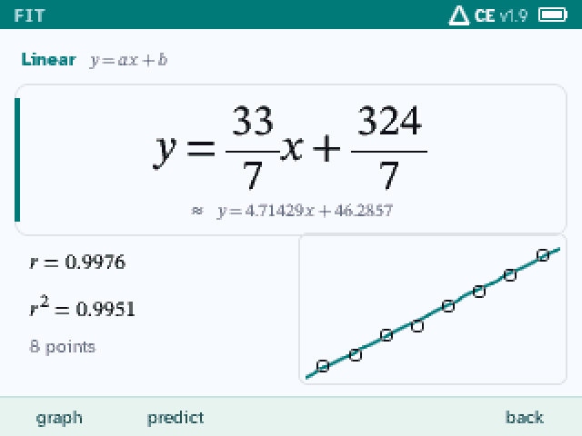 |
| statistics: your data | a column's statistics | a fitted line, exact |
| 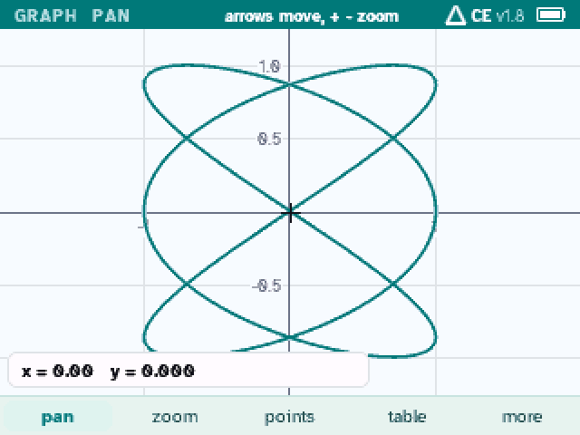 | 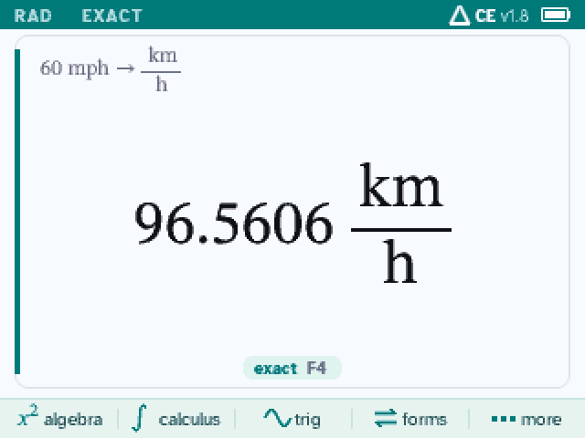 | 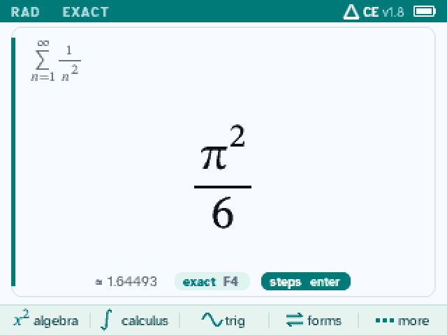 |
| parametric curves | units | Σ 1/n² = π²/6 |
| 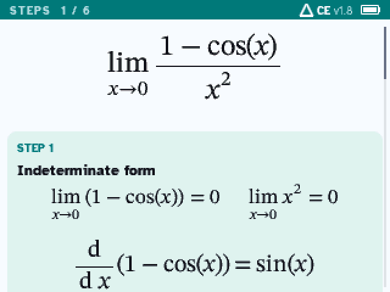 | 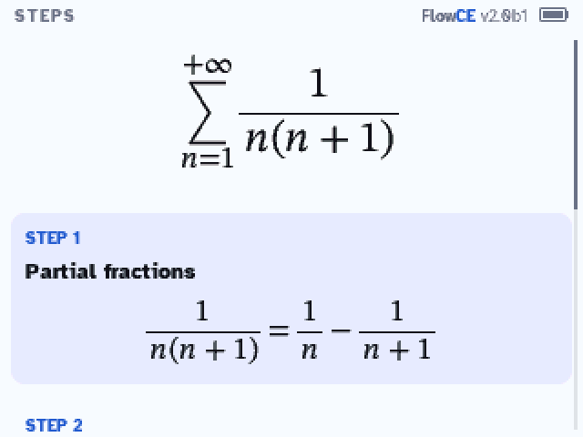 | 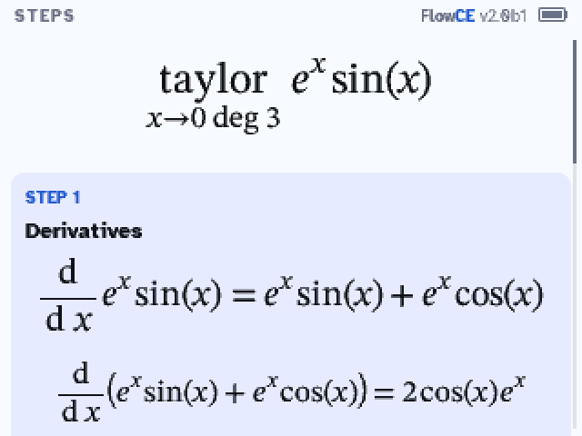 |
| steps: a limit | steps: a sum | steps: a Taylor polynomial |
| 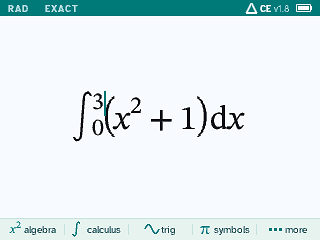 | 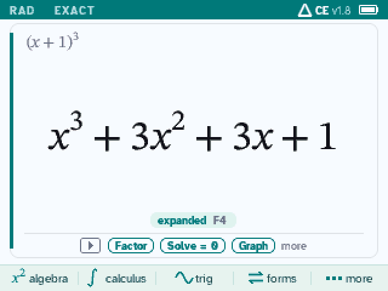 | 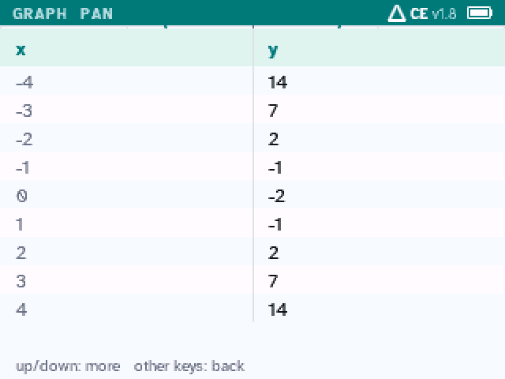 |
| type it as it looks | `F4`: other forms | a table of values |
| 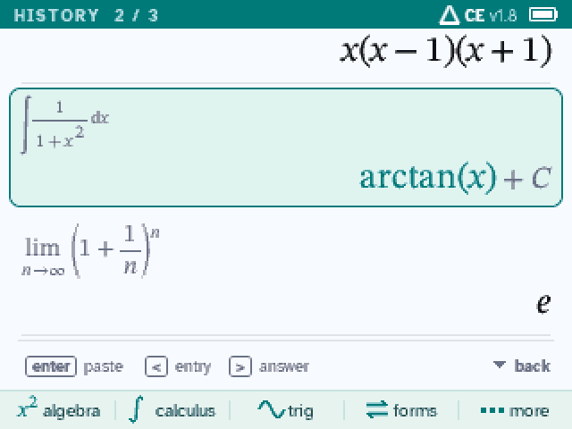 | 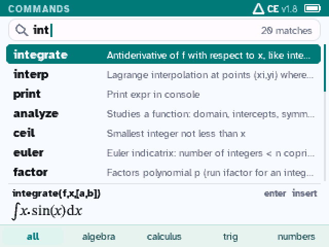 | 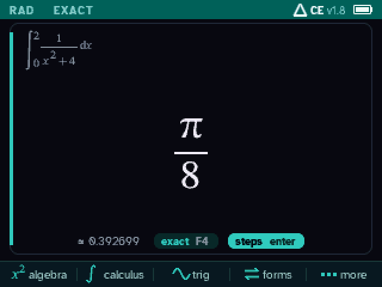 |
| history | command search | Night theme |

## Install

**The easy way: [the DeltaCE page](https://bupfff.github.io/DeltaCE/#install).** Open it in Chrome
or Edge with the calculator plugged in and click Install: it checks the calculator, erases its
archive (after you agree), sends DeltaCE and opens the installer. Press `enter` once on the
calculator: it installs and restarts by itself. On Windows it needs
[TI Connect CE](https://education.ti.com/en/products/computer-software/ti-connect-ce-sw) 6.1 or
newer installed (for its USB driver).

You need a **TI-84 Plus CE** (or TI-83 Premium CE) on **OS 5.3 to 5.8.4**. DeltaCE fills most of
the memory (about 2.7 MB), so installing it erases the calculator's apps and archived files: back
up anything you want to keep first. DeltaCE is a computer algebra system: follow your class and
test rules (some tests, like the ACT, don't allow one).

**By hand, with TI Connect CE:**

1. **Clear the memory:** `2nd` `+` (MEM) → `7:Reset...` → right arrow twice to **ALL** →
   `1:All Memory...` → `2:Reset`.
2. **Send the bundle:** download [`DeltaCE.b84`](https://github.com/bupfff/DeltaCE/releases/latest/download/DeltaCE.b84),
   drag it onto the calculator in TI Connect CE and send it.
3. **Run the installer:** `prgm` → `enter` → `enter` opens the arTIfiCE shell; `enter` starts
   INST and `enter` again installs. It counts down to 0; don't touch the calculator.
4. At *"Success! Will now reset"*, press `enter` (a few times if the screen looks odd).
5. **Start:** `clear`, then `apps` → **DeltaCE**.

| 1. Clear the memory | 3. Run the installer | 5. Start DeltaCE |
|:-:|:-:|:-:|
| 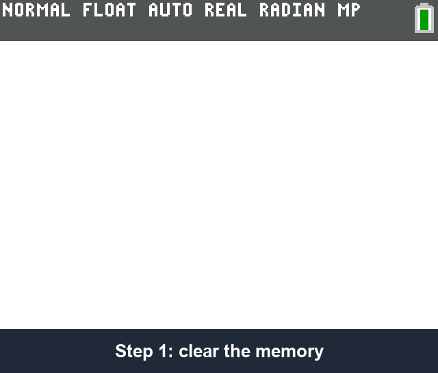 | 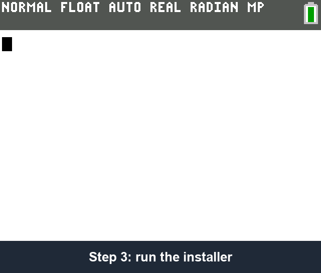 | 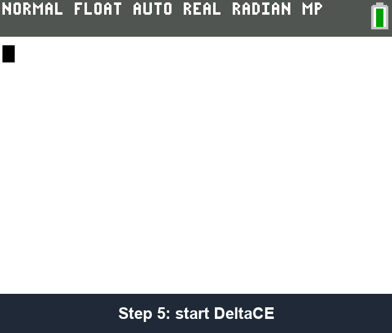 |

The bundle's INST is patched to run on OS 5.8.4 (the original stops with *"Unknown OS version"*).

**If something goes wrong**
- *The screen freezes at "Success! Will now reset":* press the reset button on the back of the
  calculator (a pen tip or a paperclip). DeltaCE stays installed.
- *The calculator acts strangely* (menus glitch, TI Connect CE stays on "refreshing"): clear the
  RAM: `2nd` `+` (MEM) → `7:Reset...` → `1:All RAM...` → `2:Reset`. This does not remove DeltaCE.
- *The calculator stays unresponsive:* hold the reset button for a few seconds.

## Keys

| Key | What it does |
|---|---|
| F1 to F5 | menus: algebra, calculus, trig, symbols, more (with `2nd` or `alpha`: more menus) |
| `enter` after an answer | its steps (calculus, equations, factoring, F4's forms) |
| `▶` after an answer | its action row: `◀` `▶` move, `enter` does it |
| `math` | templates: fraction, root, integrals, derivative, limit, sum |
| ▲ / ▼ | history / search every command |
| F4 on an answer | its other forms |
| `alpha` F4 | units |
| `(-)` | a minus sign; `2nd (-)` is the last answer (Ans) |
| `+` `−` `×` `÷` `^` `x²` first | works on the last answer, as on a TI (`× 2` is Ans·2) |
| `2nd enter` | the last input again (ENTRY); press again for the one before |
| `sto→` | stores a value: `5 → b` |
| ON while computing | stops the calculation |
| *more* → Graph | graphs the line or the answer: F1 pan or trace, F2 zoom, F3 key points and tools, F4 table, F5 more |
| *more* → Statistics | data in L1 and L2: F1/F2 a column's statistics, F3 fit a curve, F4 plot the points, F5 edit (insert, delete, sort, clear) |
| `mode` | settings (*Simplify answers* on or off), shortcuts, about |
| `2nd quit` | quit (your session is kept) |

## Building

DeltaCE is built on macOS with the [CE C/C++ toolchain](https://github.com/CE-Programming/toolchain)
**v15** (`steps-units`: `make APPLANG=en STEPS=1 UNITS=1`, linked as an application), packed by
`app_tools/pack_app.py` and cut into 41-42 AppIns pieces by `app_tools/make_segments.py`. Clone with
`--recursive`: the math engine is the `src/giac` submodule, a fork of FlowCE's with fixes for the
calculator's 24-bit `int`. `layout.ld` places the code in flash for the flash cache (made from
emulator traces of training sessions); a build of other code ignores it. The app must fit in
2,818,045 bytes; INST stops on a last piece under 1 KB, so such a build is padded.

`tools/emu/` drives the CEmu emulator for the regression tests, the screenshots and the GIFs above
(it needs your own calculator's ROM dump, which is never shared), `tools/hostgiac/` builds the
same engine on a computer to compare answers, and `tests/host/` holds host tests of the editor
and the 2D layout.

## Credits and license

DeltaCE, by Gabriel, is a fork of [FlowCE](https://github.com/tommyb3ll/FlowCE) by Tommy Bell,
which is a fork of [KhiCAS](https://www-fourier.univ-grenoble-alpes.fr/~parisse/) by Bernard
Parisse.

- **Math engine:** Giac, by Bernard Parisse and contributors (Institut Fourier, Université
  Grenoble Alpes).
- **Interface, steps and the web installer:** FlowCE, by Tommy Bell.
- **Console interface:** adapted from Eigenmath for the Casio Prizm by G. Maia, Mike Smith,
  Nemhardy and LePhenixNoir.
- **Thanks** to Adrien Bertrand, Xavier Andreani and the TI-83/84 development community,
  especially Jacob Young, commandblockguy and Matt Waltz.
- **Installer:** [arTIfiCE](https://yvantt.github.io/arTIfiCE/) by YvanTT.
- **Fonts:** Atkinson Hyperlegible (Braille Institute) and STIX Two, under the SIL Open Font
  License (`tools/fonts/src`).

DeltaCE is free software under the [GNU General Public License](LICENSE), version 3 or later. It
comes with no warranty. Not affiliated with Texas Instruments; TI-84 Plus CE is a trademark of
Texas Instruments.
